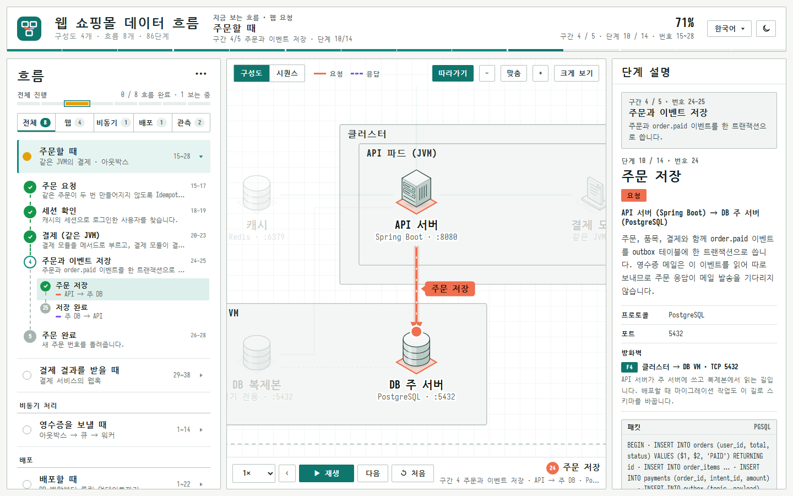
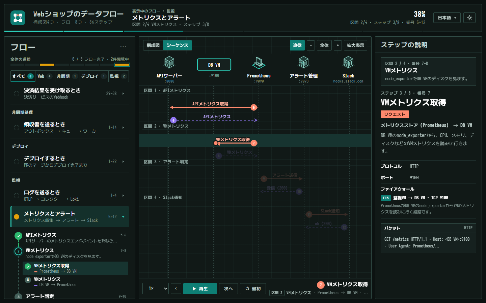

<p align="center">
  
</p>

<h2 align="center">flow-explorer</h2>

<p align="center">
  <a href=".claude-plugin/plugin.json"></a>
  <a href="LICENSE"></a>
  <a href="skills/flow-explorer/SKILL.md"></a>
  <a href="https://www.python.org/"></a>
</p>

<p align="center">
  <strong>프로젝트의 구성과 요청·응답 흐름을 단계별로 재생하는 데이터 흐름 탐색기를 HTML 파일 하나로 만듭니다.</strong><br>
  글꼴·로고·데이터가 모두 들어 있어 인터넷 없이 열립니다. 화면은 한국어이고, 번역 파일을 더하면 일본어로도 볼 수 있습니다.
</p>

---

Claude Code 플러그인입니다. 설치한 뒤 "이 저장소의 데이터 흐름 탐색기 만들어줘"라고 하면 `flow-explorer` 스킬이 저장소를 읽어 서버·컨테이너·DB·외부 서비스의 구성도와 흐름 데이터를 만들고, 그 자리에서 HTML 하나로 빌드합니다.





<p align="center"><sub>두 화면 모두 <a href="examples/web-shop">examples/web-shop</a> 예제입니다.</sub></p>

### 화면 구성

| 영역 | 내용 |
|---|---|
| **왼쪽** | 흐름 목록과 구간·단계 진행(지나간 단계는 초록 체크), 흐름마다 끝까지 봤는지 보여 주는 전체 진행, 구성도별 필터 탭 |
| **가운데** | 아이소메트릭 구성도(패킷이 노드 사이를 움직이고 카메라가 단계를 따라감)와 시퀀스 화면. 구성도는 여러 개를 둘 수 있고, VM·망·외부 시스템 상자와 번호 없는 배경 연결(복제, 대시보드가 읽는 데이터 등)도 그립니다 |
| **오른쪽** | 단계 설명: 경로, 프로토콜, 포트, 방화벽 규칙과 여는 이유, 실제 패킷. 같은 프로세스 안의 메서드 호출은 패킷 대신 호출로 보여 줍니다 |
| **머리** | 지금 보는 흐름과 진행률, 언어 메뉴(한국어·日本語), 라이트·다크 테마 |

화면 글자는 엔진이 바꾸고, 데이터 글은 번역 파일(`ja.js`)이 바꿉니다. 색은 데이터 폴더의 CSS 파일로 바꿀 수 있습니다(`data.json`의 `css`).

## 설치

### 플러그인

Claude Code 안에서 실행합니다.

```text
/plugin marketplace add wongi-jeong/flow-explorer
/plugin install flow-explorer@flow-explorer
```

### 빌드 도구

빌드는 Python으로 합니다. 글꼴 부분 집합과 스크린샷 검사에 아래 패키지가 필요합니다.

```bash
# Python 3.10 이상
pip install fonttools brotli playwright
python -m playwright install chromium
```

## 빠른 시작

### 내 프로젝트에서

프로젝트 폴더를 연 Claude Code에서 요청하면 됩니다. 스킬을 직접 부를 수도 있습니다.

```text
이 저장소의 데이터 흐름 탐색기 만들어줘
```

```text
/flow-explorer:flow-explorer
```

### 예제 빌드

```bash
# 로고 받기 (각 회사의 상표라 저장소에 넣지 않고 빌드 전에 받습니다)
python skills/flow-explorer/fetch_icons.py examples/web-oauth

# HTML 하나로 빌드
python skills/flow-explorer/build.py examples/web-oauth out/web-oauth.html

# 검사: 모든 단계를 지나며 JS 오류 · 패킷 누락 · 로고 겹침 · 번역 누락을 보고 스크린샷을 남김
python skills/flow-explorer/tests/smoke.py out/web-oauth.html out/shots
```

web-shop은 Loki 로고를 공식 파일로 받는 인수가 하나 더 필요합니다. [examples/README.md](examples/README.md)에 있습니다.

## 예제

| 폴더 | 내용 | 크기 |
|---|---|---|
| [web-shop](examples/web-shop) | 쇼핑몰 웹 서비스. 웹 요청 · 비동기 처리 · 배포 · 관측 구성도 4개. 데이터 형식의 기능을 모두 씁니다 | 흐름 8개 · 86단계 |
| [web-oauth](examples/web-oauth) | nginx 뒤의 앱 서버와 PostgreSQL, Keycloak OpenID Connect 로그인(인가 코드 + PKCE). 구성도 하나로 된 작은 예제 | 흐름 4개 · 36단계 |

## 데이터 형식

프로젝트마다 다른 내용은 데이터 폴더에만 씁니다. 엔진은 고치지 않습니다.

| 파일 | 내용 |
|---|---|
| `data.json` | 제목, 언어 목록, 구성도·스크립트 파일 목록 |
| `topology.js` | 노드, 선, 그룹 상자, 방화벽 규칙, 구성도(여러 개 가능) |
| `flows.js` | 흐름과 단계(경로 · 프로토콜 · 포트 · 방화벽), 흐름 단계 이름 |
| `groups.js` | 단계를 묶는 구간과 설명 |
| `packets.js` | 단계마다 실제로 오가는 패킷 |
| `ja.js` | 데이터 글의 일본어 번역(선택) |
| `theme.css` | 엔진의 CSS 변수를 덮어써 색을 바꿈(선택, `data.json`의 `css`에 적음) |

전체 형식은 [skills/flow-explorer/references/data-format.md](skills/flow-explorer/references/data-format.md)에 있습니다.

## 라이선스

- **코드**: [MIT](LICENSE)
- **글꼴**: SIL Open Font License 1.1. 원문은 [skills/flow-explorer/engine/fonts/](skills/flow-explorer/engine/fonts/)에 있고, 빌드한 HTML에도 글꼴마다 저작권과 OFL 정보가 들어갑니다.
  - [Iosevka](https://github.com/be5invis/Iosevka) 22.1.2: 라틴 글자, 문장 부호, 화살표, 도형 일부만 남긴 부분 글꼴
  - [Nanum Gothic Coding](https://github.com/naver/nanumfont): 빌드할 때 페이지에 쓰인 글자만 골라 넣습니다. 예약 글꼴 이름 조항에 따라 줄인 글꼴의 이름은 "Flow Hangul Coding"입니다
  - [M PLUS 1 Code](https://github.com/coz-m/MPLUS_FONTS): 데이터에 일본어(`ja`)가 있을 때만 쓰인 글자를 골라 굵기 400·700으로 넣습니다
- **로고**: 각 회사의 상표입니다. 이 저장소에는 넣지 않고, `fetch_icons.py`가 [svgl](https://svgl.app), [devicon](https://devicon.dev), [gilbarbara/logos](https://github.com/gilbarbara/logos)에서 받습니다.

## 감사

패킷이 오가는 모습을 단계별로 보여 주는 화면은 Dilum Sanjaya의 [Protocol Explorer](https://protocol-explorer-alpha.vercel.app/)에서 아이디어를 얻었습니다. 이 저장소의 코드, 색, 아이콘은 따로 만든 것입니다.

Inspired by [Protocol Explorer](https://protocol-explorer-alpha.vercel.app/) by Dilum Sanjaya. The code, colors and icons in this repository are original work.

---
